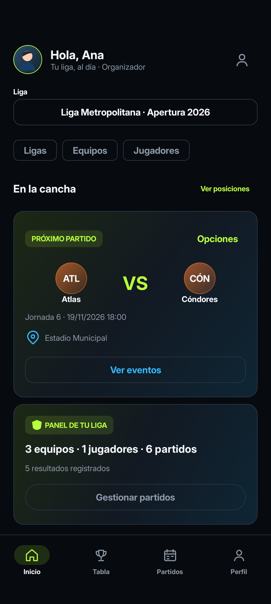
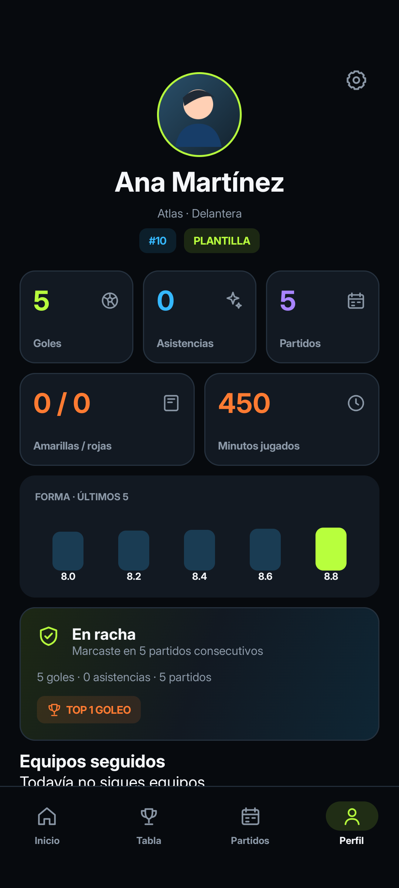
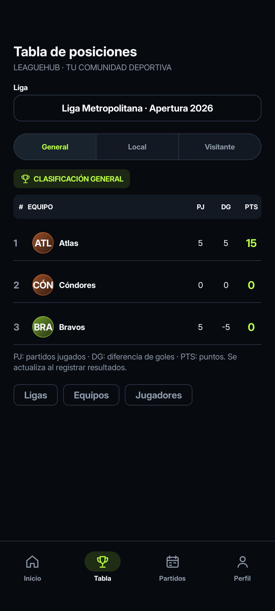

# LeagueHub

Aplicación Android local en Jetpack Compose para administrar ligas, equipos, jugadores,
partidos, resultados y estadísticas. La gestión deportiva usa datos de Room/SQLite y funciona sin conexión ni servidor propio.
Inicio también consulta un anuncio remoto de demostración cuando hay Internet; un error de red
no bloquea las funciones locales.

## Retomar aquí: rama `featureFirebase` · Firebase 1.2

**El código está integrado y la rama local estable sigue en `FeatureFinal`.** El archivo que se
proporcionó corresponde al proyecto `leaguehub-ffd96` y al paquete `com.leaguehub.app`; se copió
a `app/google-services.json`. Ese archivo se excluye de Git y no se han solicitado claves de
administrador. En otra máquina vuelve a descargarlo de Firebase Console y colócalo en `app/`.
Sin el archivo la aplicación compila y conserva el modo local, pero no activa Firebase.

### Lo que falta en Firebase Console, antes de la exposición

1. Abrir el proyecto **leaguehub-ffd96** y habilitar **Authentication → Correo electrónico/contraseña**.
2. Crear **Cloud Firestore Standard**, base `(default)`, si todavía no existe, eligiendo su ubicación.
3. Publicar **exactamente** las reglas de `firebase/firestore.rules`. Desde esta carpeta:

```powershell
cd firebase
npm ci --include=dev
npx firebase login
npx firebase deploy --project leaguehub-ffd96 --only firestore:rules,firestore:indexes
cd ..
```

También se pueden copiar las reglas a la pestaña Reglas de Firestore Console. No dejar reglas
abiertas de modo prueba. El JSON de Android no permite publicar reglas ni activar servicios;
para esos pasos hace falta la sesión del dueño del proyecto en Console/CLI.

4. Antes de actualizar, exportar un respaldo desde la versión local y conservar el APK 1.1.
   Instalar el APK de esta rama **en dos teléfonos**, sin borrar la instalación anterior. En el
primero entrar con la cuenta local o ir a **Perfil → Configuración → Sincronización Firebase** y
conectarla con su contraseña. Esperar **Sincronización al día**. Entrar con el mismo correo y
contraseña en el segundo, crear/editar un resultado y comprobar el cambio en ambos.
5. Probar la reconexión y cerrar un conflicto desde esa pantalla antes de la exposición.

**No se ha verificado producción ni desplegado reglas en el proyecto real.** Las pruebas de
sincronización usan Auth/Firestore Emulator Suite y dos clientes SDK con bases Room separadas.
No deben confundirse con una prueba física en dos teléfonos contra el proyecto de producción.

### Implementación que ya está en esta rama

- Firebase Authentication para registro, acceso, vinculación de cuentas locales, cambio de
  contraseña y solicitud real del enlace de recuperación por correo.
- Room v5 conserva la base anterior con una migración `4 → 5`, sin migración destructiva.
  Los IDs locales de las cuentas existentes se mantienen; un vínculo al UID de Firebase permite
  reconocer al mismo usuario en otro teléfono.
- Las ligas, equipos, jugadores, partidos, resultados, eventos, alineaciones, sustituciones y
  reloj se intercambian por Firestore. Las ligas sincronizadas son visibles para usuarios
  autenticados de este proyecto; solo su dueño puede escribirlas.
- Una cola durable por liga se actualiza mediante triggers SQLite en la misma transacción
  que los formularios existentes. Si se cierra el proceso o no hay conexión, los cambios siguen
  en Room. Las descargas remotas se aplican en una transacción con validación de referencias.
- Cada liga usa una revisión y transacciones de Firestore. Dos ediciones diferentes generan un
  conflicto visible; no se descarta una versión en silencio. Al elegir una, se guarda una copia
  local exportable de la otra. Las eliminaciones dejan una marca remota versionada para evitar
  que un teléfono desconectado restaure datos borrados.
- La pantalla de sincronización tiene su propio Screen/ViewModel/State/Event/Route, con estado,
  errores, reintento, conflictos y exportación de cada copia de recuperación.
- La cuenta demo mantiene `demo@leaguehub.app` / `DemoLiga2026!`, salvo que el usuario haya
  cambiado su contraseña. Primero hay que conectarla en un teléfono para crear su acceso en
  Firebase y publicar su liga. El segundo debe usar esas mismas credenciales.

### Validación de esta entrega Firebase

- APK `1.2-firebase` (código 3), disponible en [`APK/LeagueHub-debug.apk`](APK/LeagueHub-debug.apk).
- 25 pruebas JVM y 34 pruebas instrumentadas Android aprobadas, sin pruebas omitidas.
- 5 pruebas de reglas Firestore aprobadas. Build y lint correctos: 0 errores, 34 advertencias.
- Se probó migración Room v4 → v5 con conservación de datos, SDK Firebase con dos clientes,
  cola tras reabrir la base, reconexión, conflictos, copia recuperable, eliminación remota,
  documentos inválidos, cambio de contraseña y solicitud de recuperación en emuladores.
- Compilación sin `google-services.json` también verificada para conservar el modo local.
- Captura de la nueva pantalla con un estado de prueba: [sincronización](docs/capturas/firebase/sincronizacion.png).
- Para otra IA: empezar por [`docs/FIREBASE_CONTINUAR.md`](docs/FIREBASE_CONTINUAR.md),
  continuar en `featureFirebase` y completar primero la configuración manual y las pruebas reales.

### Límites y pendientes reales

- La actualización conserva los datos al migrar de Room v4 a v5. El APK antiguo 1.1 no puede abrir
  directamente una base v5: no forzar un downgrade. Conservar el respaldo previo y la rama estable.

- Las fotos/URI de galería **no** se suben: una URI del teléfono no funciona en otro. La galería
  local se conserva cuando una revisión remota mantiene el partido. Para compartir las imágenes
  falta integrar Firebase Storage y sus reglas; no se ha habilitado facturación ni Storage.
- Apariencia, equipos seguidos y marcas de lectura permanecen por dispositivo. El perfil privado
  guarda nombre, modo y liga seleccionada para el acceso en otra instalación.
- El buscador de cuentas para vincular jugadores por correo continúa siendo local. Para enlazar
  una cuenta que solo existe en otro teléfono falta diseñar un directorio/búsqueda con privacidad;
  no publicar correos de todos los usuarios como solución rápida.
- Cada liga se transmite como una unidad atómica con un máximo de **750 KB**. La aplicación
  rechaza superar ese límite y conserva los datos locales. Para volúmenes mayores hay que dividir
  por temporadas o sustituir el agregado por subcolecciones con su propio protocolo de revisiones.
- La vinculación inicial necesita los servicios configurados y conexión. Si Firebase no está
  disponible, una cuenta local válida puede seguir usándose localmente; no significa que ya
  esté sincronizada. La pantalla de estado distingue estos casos.
- OCR, predicciones de IA y notificaciones push siguen pendientes, como se acordó.

Más contexto técnico y comandos de pruebas: [docs/FIREBASE_CONTINUAR.md](docs/FIREBASE_CONTINUAR.md).

## Ejecutar

1. Abrir esta carpeta (`leaguehub`) en Android Studio.
2. Usar JDK 25 y Android SDK 37. Ajustar `local.properties` a la ruta del SDK de cada máquina.
3. Ejecutar `app` en un dispositivo Android 8.0/API 26 o posterior.

```powershell
.\gradlew.bat :app:testDebugUnitTest :app:assembleDebug :app:lintDebug
.\gradlew.bat :app:connectedDebugAndroidTest
```

La última tarea requiere emulador o teléfono conectado. El APK de entrega es
`APK/LeagueHub-debug.apk`; el APK que genera Gradle está en
`app/build/outputs/apk/debug/app-debug.apk`.

## Interfaz recuperada

Las pantallas principales recuperan los componentes del diseño deportivo original: avatar y
estadísticas de perfil, portada con marcador y resultados recientes, tabla compacta y calendario
mensual. Los catálogos de ligas, equipos y jugadores, el centro del partido y los respaldos usan
el mismo estilo. Se conservan la navegación tipada, MVI y las operaciones de Room.

El perfil muestra la cuenta activa y las estadísticas de su jugador vinculado. La forma, la racha
y la posición de goleo se calculan con los eventos de partidos terminados; cuando no hay historial
se muestran estados vacíos. Los filtros General/Local/Visitante y el calendario por mes/día son
funcionales. Las opciones de edición, ubicación y compartir están en el menú de cada partido.

| Inicio | Perfil | Tabla | Calendario |
|---|---|---|---|
|  |  |  |  |

Las capturas proceden de `InterfaceRecoveryTest` con una cuenta de prueba y datos en Room en
memoria. Esos registros no se agregan a la base de producción ni al instalar el APK. La prueba
comprueba identidad de sesión, estadísticas, filtros de posiciones y selección de fechas.

## Cuenta de demostración

Instala el APK actualizado e inicia sesión con:

- **Correo:** `demo@leaguehub.app`
- **Contraseña:** `DemoLiga2026!`
- **Perfil:** Ana Torres, organizadora y jugadora de Falcons.

El primer acceso con estas credenciales crea una liga local con 6 equipos, 36 jugadores,
15 partidos terminados, 6 pendientes y sus eventos. El perfil de Ana tiene 5 partidos,
5 goles, 3 asistencias, 3 amarillas, 450 minutos y cinco valoraciones. También hay equipos
seguidos, tabla de posiciones y resultados recientes. Las fechas se calculan en el primer
acceso para que haya próximos partidos en el calendario.

Los datos se guardan en Room y se pueden editar. Volver a iniciar sesión no duplica la liga,
no revierte cambios ni restaura eliminaciones. Si cambias la contraseña de esta cuenta,
deberás usar tu nueva contraseña. La cuenta demo local se prepara al iniciar sesión y funciona sin Internet; vincularla a Firebase y acceder desde otro teléfono requiere la configuración y conexión indicadas al principio.

## Flujo recuperado de Figma · versión 1.1

Referencia: [LeagueHub — App móvil y flujo completo](https://www.figma.com/design/IAhnhFIXe7V2smEV0zrRt6/LeagueHub-%E2%80%94-App-m%C3%B3vil-y-flujo-completo?node-id=1-2).

Se recupera el recorrido con datos locales, conservando las cuentas, formularios, resultados,
respaldos y el diseño de Inicio, Perfil, Tabla y Calendario. Cada nueva funcionalidad de
`feature/local` tiene `Screen`, `ViewModel`, `State`, `Event` y `Route`. Los detalles reciben
solo IDs mediante destinos `@Serializable`; las pantallas emiten eventos y el ViewModel
expone un `StateFlow`.

| Vista / recorrido | Comportamiento disponible |
|---|---|
| Detalle de liga | Diseño original, equipos, progreso y resultados guardados. Acceso desde Ligas → Detalle de liga o Explorar. |
| Detalle de equipo | Diseño original con escudo, posición, próximo partido, seguimiento, plantilla desplegable y ficha estadística de cada jugador. |
| Detalle del partido | Diseño original con marcador, horario, cancha, compartir y ruta en una aplicación de mapas. La imagen del mapa es ilustrativa; no inventa distancias ni tiempos de viaje. |
| Match Center · Resumen | Cronología real de goles, asistencias, tarjetas y cambios; acceso al registro de eventos. |
| Match Center · Alineación | Cancha, titulares/suplentes, formaciones de 5/7/11, sustituciones y reingresos. El selector de minuto permite revisar quién estaba en cancha. |
| Minutos jugados | Calcula los intervalos de titulares y cambios de ambos equipos; permite guardar las participaciones y conservar las valoraciones de quienes jugaron. |
| Match Center · Estadísticas | Barras comparativas de goles registrados, asistencias, amarillas, rojas y participaciones. |
| Match Center · Galería | El organizador agrega imágenes con el selector de Android. Las referencias se guardan con permisos de lectura persistentes. Quitar una foto de la galería no borra el archivo original. |
| Control del partido | Inicio/reanudación, descanso y minuto manual. Marcador en vivo derivado de goles capturados. Publicar el resultado actualiza tabla y perfil; volver a programado restablece el estado de reloj. |
| Panel organizador | Progreso de resultados, equipos/jugadores y actas pendientes, con acceso al control de cada partido. |
| Notificaciones | Actividad local de la liga y equipos seguidos, filtros y estado leído persistente por cuenta. |
| Configuración | Cuenta, contraseña, apariencia, privacidad, modo jugador/organizador, cambio de liga y respaldos. |
| Explorar | Búsqueda de las ligas disponibles en el teléfono y acceso a sus detalles. |

Las alineaciones, cambios, reloj y referencias de galería se almacenan como documentos JSON
en la tabla `user_data` de Room/SQLite, asociados al dueño de la liga y al partido. No requieren
borrar la base ni cambiar su esquema. Los repositorios verifican propiedad, pertenencia de
jugadores y coherencia temporal; las alineaciones protegen a los jugadores frente a borrados o
traslados que romperían su historial. Los respaldos incluyen alineaciones/cambios/reloj y
reasignan sus IDs al importar. Las fotos y sus permisos quedan en el dispositivo y no se exportan.

La cuenta demo conserva las mismas credenciales. Al entrar incorpora, una sola vez,
alineaciones para sus partidos existentes sin reemplazar las que se hayan editado. Para probar:
**Inicio → Abrir Match Center → Alineación**. Configuración está en el engranaje de Perfil;
las notificaciones, en la campana de Inicio.

El flujo local no incorpora reconocimiento OCR, predicciones de IA, medición de posesión/tiros,
notificaciones push ni sincronización entre teléfonos. La captura de eventos y resultados es
manual. No hay botones que simulen esos servicios. La consulta remota de demostración de
Inicio se conserva como llamada real a Internet.

Las capturas de los recorridos recuperados están en [docs/capturas/recuperadas](docs/capturas/recuperadas).
Se generaron con `RestoredViewsFlowTest` usando Room en memoria y el grafo de navegación real.
La verificación de esta versión pasó 25 pruebas unitarias y 30 instrumentadas en Pixel 8/API 37,
compilación y lint sin errores. Los avisos de lint restantes no bloquean la compilación.

## Servicios

| Servicio | Función y condiciones |
|---|---|
| Base propia Room/SQLite | Guarda cuentas, ligas, plantillas, partidos, resultados, eventos y preferencias en el teléfono. Es la fuente de los datos deportivos, no una API deportiva externa. |
| Firebase Authentication y acceso local | Esta rama vincula las cuentas a Firebase con correo/contraseña. Room conserva el acceso y los datos locales cuando no hay conexión. Las contraseñas y sus hashes no se escriben en Firestore. No se integró acceso Google/Apple. |
| Cloud Firestore | Sincroniza datos deportivos por liga con revisiones, reglas de propiedad y conflictos explícitos. Requiere activar la base y publicar las reglas incluidas. |
| [JSONPlaceholder](https://jsonplaceholder.typicode.com/) | API pública de datos ficticios. Inicio ejecuta `GET https://jsonplaceholder.typicode.com/posts/1` mediante Retrofit y muestra su título como anuncio de demostración. La documentación oficial indica que no requiere registro ni API key. No se presenta como una noticia deportiva real. |
| Selector de documentos de Android | Exporta/importa respaldos JSON mediante Storage Access Framework, sin permisos generales de almacenamiento. |
| Compartir y mapas de Android | Abre el selector del sistema para compartir y una aplicación de mapas instalada para consultar la cancha. No utiliza el SDK de Google Maps ni consulta la ubicación GPS. |

La llamada obligatoria a Internet está en el recorrido real: **Registro/Login → Inicio →
Anuncio remoto · demostración**. Se realiza al crear el ViewModel de Inicio y se puede repetir
con **Actualizar anuncio / Reintentar conexión**. El estado muestra carga, datos o error.
Para demostrar el manejo sin conexión, abrir Inicio sin Internet: el aviso permite reintentar
y los formularios, Room, la tabla y los respaldos siguen disponibles. La API externa no guarda
los datos de la liga; esas operaciones permanecen locales.

## Librerías

- **Jetpack Compose y Material 3:** interfaz declarativa, formularios, listas, diálogos y temas.
- **Navigation Compose:** grafo de pantallas y navegación type-safe entre destinos `@Serializable`.
- **Kotlin Serialization:** serialización de destinos y formato JSON versionado de los respaldos.
- **AndroidX Lifecycle y ViewModel:** estado por pantalla, ciclo de vida y `collectAsStateWithLifecycle`.
- **Kotlin Coroutines / Flow / StateFlow:** operaciones asíncronas, estado observable y efectos de navegación.
- **Room / SQLite:** entidades relacionadas, consultas observables, transacciones y migraciones locales.
- **Firebase Auth + Firestore (BoM 34.7.0):** autenticación y sincronización opcional de esta rama. Google Services 4.4.4 procesa la configuración Android local.
- **Retrofit + Gson:** llamada HTTP y conversión del anuncio remoto de JSONPlaceholder.
- **AndroidX Activity Result:** contratos de selección y creación de archivos de Android.
- **JUnit, AndroidX Test, Compose UI Test y Espresso:** infraestructura de pruebas unitarias e instrumentadas.

## Navegación y MVI para la rúbrica

Cada funcionalidad activa tiene su carpeta en `feature/local`: `home`, `leagues`, `clubs`,
`players`, `matches`, `events`, `standings`, `profile` y `backup`. Cada una incluye archivos
**Screen, ViewModel, State (data class), Event (sealed interface) y Route**.
Por ejemplo, `leagues/` contiene `LeaguesScreen.kt`, `LeaguesViewModel.kt`, `LeaguesState.kt`,
`LeaguesEvent.kt` y `LeaguesRoute.kt`. Acceso, registro, recuperación, bienvenida, splash y rol
conservan igualmente sus archivos MVI dentro de `feature/auth` y `feature/onboarding`.

El flujo es **Screen → Event → ViewModel → StateFlow → Route → Screen**. Los Screen reciben
únicamente estado y una función de eventos. Los filtros, permisos, cálculos, consultas y guardado
se procesan fuera de los composables. Solo se usa `remember` para estado visual como desplegables
y desplazamiento. Los Intents y selectores de archivo se ejecutan en Route a partir de efectos.

`LocalHubViewModel`, `LocalState` y `LocalEvent` forman un coordinador compartido del grafo para
los comandos comunes de formularios, sesión y persistencia; no sustituyen los ViewModels y estados
individuales de las pantallas. Cada ViewModel de funcionalidad prepara sus propios modelos de
presentación y procesa sus eventos. Los datos compartidos permanecen en repositorios y Room.

`LocalNavigation.kt` registra un grafo anidado `LocalHubDestination` con nueve destinos reales:
Inicio, Ligas, Equipos, Jugadores, Partidos, Eventos, Tabla, Perfil y Respaldos. No se cambia de
pantalla con un enum guardado en estado ni se navega con rutas string. Los detalles reciben IDs:
`LocalPlayersDestination(clubId)` y `LocalEventsDestination(matchId)`, que sus ViewModels resuelven
contra los datos locales. El botón Atrás utiliza el back stack de Navigation Compose.

## Recorrido funcional local

1. Crear una cuenta con nombre, correo y contraseña. Elegir Organizador o Jugador.
2. Como organizador: Ligas → Crear liga → nombre y temporada.
3. Abrir la liga; Equipos → crear al menos dos equipos.
4. Jugadores → crear la plantilla, indicando equipo, nombre, posición y dorsal (1–99).
   El dorsal no se repite en el mismo equipo.
5. Para vincular un jugador con un perfil, registrar primero su cuenta en este teléfono e
   ingresar su correo en el formulario del jugador. Cada cuenta se vincula a un solo jugador.
   Dejar el correo vacío permite crear jugadores sin cuenta o quitar una vinculación.
6. Partidos → crear partido con equipos distintos de la liga, fecha, hora, cancha y jornada.
7. Ver eventos → agregar o editar goles, asistencias, tarjetas y participaciones. Una
   participación permite guardar minutos jugados y valoración opcional de 0 a 10.
8. Registrar resultado → ingresar ambos marcadores. Se puede corregir el resultado o volver
   el partido a Programado. El marcador no puede ser menor que los goles ya registrados.
9. Tabla refleja los resultados: victoria 3 puntos, empate 1. Desempates por diferencia de
   goles, goles a favor y nombre. Perfil y Jugadores calculan estadísticas desde los eventos
   de partidos con resultado. Corregir, reabrir o eliminar partidos recalcula los totales.
10. Perfil permite editar el nombre de la cuenta, cambiar contraseña verificando la actual,
    cambiar apariencia y modo, y cerrar sesión. Las contraseñas no se muestran ni se guardan
    en texto plano. Para volver a entrar se usa el correo y la contraseña registrados.

Las ligas del dispositivo se pueden consultar desde cualquier cuenta. Solo su creador, en modo
Organizador, puede modificarlas. Cambiar a organizador no permite editar ligas ajenas.

La eliminación solicita confirmación. Para borrar ligas o equipos se deben quitar primero
sus dependencias. Un jugador con eventos no se puede eliminar ni trasladar a otro equipo.
Eliminar un partido elimina también sus eventos y actualiza las estadísticas.

## Respaldos locales

En **Perfil → Respaldos**, en modo Organizador, están **Exportar respaldo** e **Importar respaldo**.
El selector de archivos de Android permite elegir el destino o el archivo sin permisos generales
de almacenamiento.

- Exportar guarda en JSON todas las ligas creadas por la cuenta activa y sus equipos, jugadores,
  partidos y eventos. La lectura se hace en una transacción para obtener una copia consistente.
- Importar valida formato, versión, campos obligatorios, identificadores, relaciones, fechas,
  dorsales, marcadores, eventos y valoraciones. El límite es 8 MB y 50 000 registros.
- Antes de guardar aparece una vista previa con las cantidades y las ligas incluidas. Cancelar
  no cambia la base. Un respaldo vacío se puede consultar, pero no tiene copias que importar.
- Confirmar crea ligas con el sufijo `(copia)`, nuevos identificadores y el propietario actual.
  No sobrescribe ni fusiona registros existentes. Importar nuevamente crea otras copias. Después de importar, abrir Ligas para encontrarlas.
- No se exportan cuentas, correos de acceso, contraseñas, sesiones, preferencias ni vínculos de
  jugadores con cuentas. Los jugadores importados se pueden vincular después desde Jugadores.
- Tabla y estadísticas se recalculan desde los resultados y eventos restaurados. Todo el guardado
  usa una única transacción: si falla cualquier registro, no se conserva ninguna parte de esa importación.

El formato es `leaguehub-backup`, versión `1`, con fecha ISO y arreglos `leagues`, `clubs`,
`players`, `fixtures` y `events`. El archivo es UTF-8 y contiene nombres y datos deportivos
legibles, sin cifrado. Para trasladar una liga a otro teléfono, crear primero una cuenta allí,
elegir modo Organizador e importar el archivo.

## Persistencia y arquitectura

Room v4 almacena la base privada `leaguehub.db` en la ruta de
`context.getDatabasePath("leaguehub.db")`, habitualmente
`/data/user/0/com.leaguehub.app/databases/leaguehub.db`.

| Tabla | Datos |
|---|---|
| `user_accounts` | Cuentas, hash PBKDF2 y sal aleatoria, preferencias de rol/liga |
| `user_session` | Sesión activa |
| `user_data` | Preferencias locales por cuenta; también conserva snapshots históricos |
| `leagues` | Liga, temporada y propietario |
| `clubs` | Equipos relacionados con su liga |
| `players` | Plantilla y vínculo opcional con una cuenta |
| `fixtures` | Partidos y sus resultados |
| `match_events` | Eventos, participaciones, minutos y valoraciones |

Las migraciones 1→2→3→4 conservan cuentas y datos estructurados existentes. Las antiguas
sesiones de demostración que no tenían cuenta se cierran al arrancar y se solicita crear
una cuenta local. Los catálogos falsos anteriores nunca fueron ligas guardadas y no se
convierten en registros reales.

`CompetitionRepository` valida propiedad y relaciones dentro de transacciones. Las listas
observan Room mediante Flow; la tabla y los totales se derivan de los registros actuales.
La navegación real entra por el grafo tipado `LocalHubDestination` y las carpetas MVI descritas arriba.
Los antiguos screens y fixtures se conservan como referencias de diseño y para pruebas aisladas,
fuera del recorrido principal; el grafo activo no consulta esos catálogos falsos.
Los documentos `docs/INTEGRANTE-2.md` y `docs/integrante-3.md` describen entregas históricas.

## Alcance de esta versión

Todo el recorrido anterior funciona en el mismo teléfono. GitHub guarda el código, no la base
de datos del dispositivo. En `FeatureFinal` los datos son solo locales; en `featureFirebase` las cuentas vinculadas sincronizan las ligas mediante Firestore.
En esta rama la recuperación por correo usa Firebase Authentication cuando está configurado. Los accesos Google/Apple no se han integrado.
Cámara/OCR, predicciones, avisos programados y publicación web abierta quedan fuera del flujo
local; no se presentan como acciones disponibles. Compartir un partido abre el selector de Android. Abrir ubicación delega en una aplicación de mapas instalada (su disponibilidad sin conexión depende de esa aplicación). Desde Equipos se puede seguir/dejar de seguir equipos; la selección se conserva por cuenta y aparece en Perfil.

## Continuar el desarrollo

La rama de esta integración es `featureFirebase`; `FeatureFinal` conserva la versión local estable. Recuperar con `git fetch origin`, `git switch featureFirebase`
y `git pull --ff-only`. Se hacen commits cortos en español y se suben al terminar bloques validados.
Conservar los cambios personales de Android Studio (`.idea`) que estén fuera de esos commits.

La cobertura incluye cálculos y correcciones de tabla, estadísticas, claves foráneas, propiedad,
reapertura de la base, migraciones, cuentas, vinculación y el recorrido visual de formularios y
registro → contraseña → salir → entrar → recrear actividad. No equivale a una garantía sobre
cada modelo de teléfono: las pruebas instrumentadas se ejecutan en el emulador disponible.

## Verificación de la entrega local

La entrega alineada a la rúbrica pasó compilación y lint sin errores, 25 pruebas unitarias y 30 pruebas
instrumentadas en el emulador disponible, incluyendo registro/login, cambio de contraseña,
recreación de actividad, captura por formularios, edición/eliminación, protección de dependencias,
modo de lectura, reapertura de datos y migraciones. El APK de `APK/LeagueHub-debug.apk` se
actualizó desde la compilación comprobada y se verificó su coincidencia por SHA-256.

La cobertura de respaldos comprueba exportación sin credenciales, copia independiente al importar varias veces, JSON y referencias inválidos, límites de archivo, reversión de una escritura fallida y el flujo de vista previa/cancelación desde Perfil.

La refactorización para la rúbrica incorpora pruebas sobre el grafo real: apertura de detalles
por ID, regreso entre pantallas, navegación a Respaldos y error/reintento de la consulta remota
sin impedir la gestión local. Las pruebas de red automatizadas inyectan un servicio controlado;
la aplicación normal usa el endpoint público real indicado en Servicios.

La validación final del grafo tipado comprueba detalles por ID, regreso entre pantallas y acceso a Respaldos. El escenario de Internet simula primero un fallo y después una respuesta correcta al reintentar, mientras verifica que los datos locales siguen accesibles. También se comprobó que el endpoint público GET /posts/1 responde desde el entorno de desarrollo.

La recuperación visual también pasó 25 pruebas unitarias y 30 instrumentadas en Pixel 8/API 37,
con lint sin errores. Incluye la comprobación del perfil de la cuenta activa, su historial de Room,
los filtros General/Local/Visitante y el calendario por fecha. Las capturas anteriores corresponden
al mismo código del APK actualizado de esta entrega.

