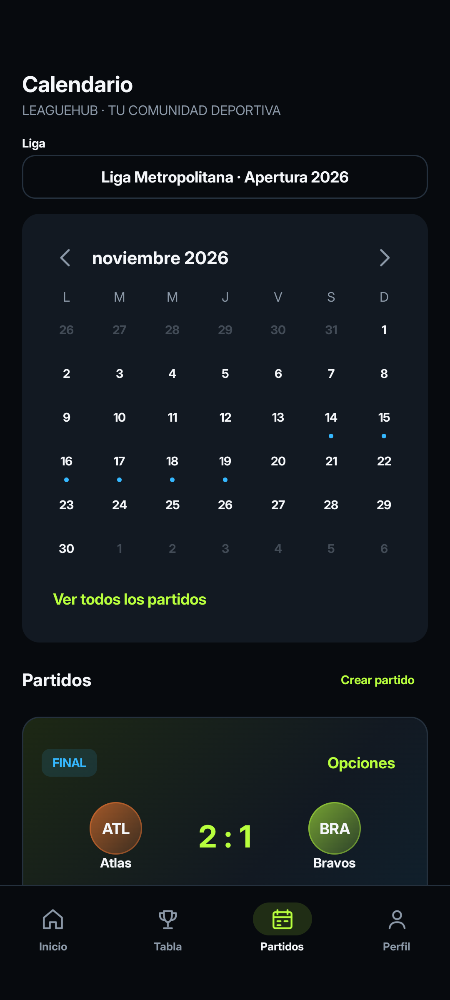

# LeagueHub

Aplicación Android local en Jetpack Compose para administrar ligas, equipos, jugadores,
partidos, resultados y estadísticas. La gestión deportiva usa datos de Room/SQLite y funciona sin conexión ni servidor propio.
Inicio también consulta un anuncio remoto de demostración cuando hay Internet; un error de red
no bloquea las funciones locales.

## Ejecutar

1. Abrir esta carpeta (`leaguehub`) en Android Studio.
2. Usar JDK 25 y Android SDK 37. Ajustar `local.properties` a la ruta del SDK de cada máquina.
3. Ejecutar `app` en un dispositivo Android 8.0/API 26 o posterior.

```powershell
.\gradlew.bat :app:testDebugUnitTest :app:assembleDebug :app:lintDebug
.\gradlew.bat :app:connectedDebugAndroidTest
```

La última tarea requiere emulador o teléfono conectado. El APK de entrega es
`APK/LeagueHub-debug.apk`; el APK que genera Gradle está en
`app/build/outputs/apk/debug/app-debug.apk`.

## Interfaz recuperada

Las pantallas principales recuperan los componentes del diseño deportivo original: avatar y
estadísticas de perfil, portada con marcador y resultados recientes, tabla compacta y calendario
mensual. Los catálogos de ligas, equipos y jugadores, el centro del partido y los respaldos usan
el mismo estilo. Se conservan la navegación tipada, MVI y las operaciones de Room.

El perfil muestra la cuenta activa y las estadísticas de su jugador vinculado. La forma, la racha
y la posición de goleo se calculan con los eventos de partidos terminados; cuando no hay historial
se muestran estados vacíos. Los filtros General/Local/Visitante y el calendario por mes/día son
funcionales. Las opciones de edición, ubicación y compartir están en el menú de cada partido.

| Inicio | Perfil | Tabla | Calendario |
|---|---|---|---|
|  |  |  |  |

Las capturas proceden de `InterfaceRecoveryTest` con una cuenta de prueba y datos en Room en
memoria. Esos registros no se agregan a la base de producción ni al instalar el APK. La prueba
comprueba identidad de sesión, estadísticas, filtros de posiciones y selección de fechas.

## Servicios

| Servicio | Función y condiciones |
|---|---|
| Base propia Room/SQLite | Guarda cuentas, ligas, plantillas, partidos, resultados, eventos y preferencias en el teléfono. Es la fuente de los datos deportivos, no una API deportiva externa. |
| Autenticación local propia | Registro y acceso mediante correo como identificador y contraseña con hash/sal. No utiliza Google, Apple ni un proveedor de autenticación en Internet. |
| [JSONPlaceholder](https://jsonplaceholder.typicode.com/) | API pública de datos ficticios. Inicio ejecuta `GET https://jsonplaceholder.typicode.com/posts/1` mediante Retrofit y muestra su título como anuncio de demostración. La documentación oficial indica que no requiere registro ni API key. No se presenta como una noticia deportiva real. |
| Selector de documentos de Android | Exporta/importa respaldos JSON mediante Storage Access Framework, sin permisos generales de almacenamiento. |
| Compartir y mapas de Android | Abre el selector del sistema para compartir y una aplicación de mapas instalada para consultar la cancha. No utiliza el SDK de Google Maps ni consulta la ubicación GPS. |

La llamada obligatoria a Internet está en el recorrido real: **Registro/Login → Inicio →
Anuncio remoto · demostración**. Se realiza al crear el ViewModel de Inicio y se puede repetir
con **Actualizar anuncio / Reintentar conexión**. El estado muestra carga, datos o error.
Para demostrar el manejo sin conexión, abrir Inicio sin Internet: el aviso permite reintentar
y los formularios, Room, la tabla y los respaldos siguen disponibles. La API externa no guarda
los datos de la liga; esas operaciones permanecen locales.

## Librerías

- **Jetpack Compose y Material 3:** interfaz declarativa, formularios, listas, diálogos y temas.
- **Navigation Compose:** grafo de pantallas y navegación type-safe entre destinos `@Serializable`.
- **Kotlin Serialization:** serialización de destinos y formato JSON versionado de los respaldos.
- **AndroidX Lifecycle y ViewModel:** estado por pantalla, ciclo de vida y `collectAsStateWithLifecycle`.
- **Kotlin Coroutines / Flow / StateFlow:** operaciones asíncronas, estado observable y efectos de navegación.
- **Room / SQLite:** entidades relacionadas, consultas observables, transacciones y migraciones locales.
- **Retrofit + Gson:** llamada HTTP y conversión del anuncio remoto de JSONPlaceholder.
- **AndroidX Activity Result:** contratos de selección y creación de archivos de Android.
- **JUnit, AndroidX Test, Compose UI Test y Espresso:** infraestructura de pruebas unitarias e instrumentadas.

## Navegación y MVI para la rúbrica

Cada funcionalidad activa tiene su carpeta en `feature/local`: `home`, `leagues`, `clubs`,
`players`, `matches`, `events`, `standings`, `profile` y `backup`. Cada una incluye archivos
**Screen, ViewModel, State (data class), Event (sealed interface) y Route**.
Por ejemplo, `leagues/` contiene `LeaguesScreen.kt`, `LeaguesViewModel.kt`, `LeaguesState.kt`,
`LeaguesEvent.kt` y `LeaguesRoute.kt`. Acceso, registro, recuperación, bienvenida, splash y rol
conservan igualmente sus archivos MVI dentro de `feature/auth` y `feature/onboarding`.

El flujo es **Screen → Event → ViewModel → StateFlow → Route → Screen**. Los Screen reciben
únicamente estado y una función de eventos. Los filtros, permisos, cálculos, consultas y guardado
se procesan fuera de los composables. Solo se usa `remember` para estado visual como desplegables
y desplazamiento. Los Intents y selectores de archivo se ejecutan en Route a partir de efectos.

`LocalHubViewModel`, `LocalState` y `LocalEvent` forman un coordinador compartido del grafo para
los comandos comunes de formularios, sesión y persistencia; no sustituyen los ViewModels y estados
individuales de las pantallas. Cada ViewModel de funcionalidad prepara sus propios modelos de
presentación y procesa sus eventos. Los datos compartidos permanecen en repositorios y Room.

`LocalNavigation.kt` registra un grafo anidado `LocalHubDestination` con nueve destinos reales:
Inicio, Ligas, Equipos, Jugadores, Partidos, Eventos, Tabla, Perfil y Respaldos. No se cambia de
pantalla con un enum guardado en estado ni se navega con rutas string. Los detalles reciben IDs:
`LocalPlayersDestination(clubId)` y `LocalEventsDestination(matchId)`, que sus ViewModels resuelven
contra los datos locales. El botón Atrás utiliza el back stack de Navigation Compose.

## Recorrido funcional local

1. Crear una cuenta con nombre, correo y contraseña. Elegir Organizador o Jugador.
2. Como organizador: Ligas → Crear liga → nombre y temporada.
3. Abrir la liga; Equipos → crear al menos dos equipos.
4. Jugadores → crear la plantilla, indicando equipo, nombre, posición y dorsal (1–99).
   El dorsal no se repite en el mismo equipo.
5. Para vincular un jugador con un perfil, registrar primero su cuenta en este teléfono e
   ingresar su correo en el formulario del jugador. Cada cuenta se vincula a un solo jugador.
   Dejar el correo vacío permite crear jugadores sin cuenta o quitar una vinculación.
6. Partidos → crear partido con equipos distintos de la liga, fecha, hora, cancha y jornada.
7. Ver eventos → agregar o editar goles, asistencias, tarjetas y participaciones. Una
   participación permite guardar minutos jugados y valoración opcional de 0 a 10.
8. Registrar resultado → ingresar ambos marcadores. Se puede corregir el resultado o volver
   el partido a Programado. El marcador no puede ser menor que los goles ya registrados.
9. Tabla refleja los resultados: victoria 3 puntos, empate 1. Desempates por diferencia de
   goles, goles a favor y nombre. Perfil y Jugadores calculan estadísticas desde los eventos
   de partidos con resultado. Corregir, reabrir o eliminar partidos recalcula los totales.
10. Perfil permite editar el nombre de la cuenta, cambiar contraseña verificando la actual,
    cambiar apariencia y modo, y cerrar sesión. Las contraseñas no se muestran ni se guardan
    en texto plano. Para volver a entrar se usa el correo y la contraseña registrados.

Las ligas del dispositivo se pueden consultar desde cualquier cuenta. Solo su creador, en modo
Organizador, puede modificarlas. Cambiar a organizador no permite editar ligas ajenas.

La eliminación solicita confirmación. Para borrar ligas o equipos se deben quitar primero
sus dependencias. Un jugador con eventos no se puede eliminar ni trasladar a otro equipo.
Eliminar un partido elimina también sus eventos y actualiza las estadísticas.

## Respaldos locales

En **Perfil → Respaldos**, en modo Organizador, están **Exportar respaldo** e **Importar respaldo**.
El selector de archivos de Android permite elegir el destino o el archivo sin permisos generales
de almacenamiento.

- Exportar guarda en JSON todas las ligas creadas por la cuenta activa y sus equipos, jugadores,
  partidos y eventos. La lectura se hace en una transacción para obtener una copia consistente.
- Importar valida formato, versión, campos obligatorios, identificadores, relaciones, fechas,
  dorsales, marcadores, eventos y valoraciones. El límite es 8 MB y 50 000 registros.
- Antes de guardar aparece una vista previa con las cantidades y las ligas incluidas. Cancelar
  no cambia la base. Un respaldo vacío se puede consultar, pero no tiene copias que importar.
- Confirmar crea ligas con el sufijo `(copia)`, nuevos identificadores y el propietario actual.
  No sobrescribe ni fusiona registros existentes. Importar nuevamente crea otras copias. Después de importar, abrir Ligas para encontrarlas.
- No se exportan cuentas, correos de acceso, contraseñas, sesiones, preferencias ni vínculos de
  jugadores con cuentas. Los jugadores importados se pueden vincular después desde Jugadores.
- Tabla y estadísticas se recalculan desde los resultados y eventos restaurados. Todo el guardado
  usa una única transacción: si falla cualquier registro, no se conserva ninguna parte de esa importación.

El formato es `leaguehub-backup`, versión `1`, con fecha ISO y arreglos `leagues`, `clubs`,
`players`, `fixtures` y `events`. El archivo es UTF-8 y contiene nombres y datos deportivos
legibles, sin cifrado. Para trasladar una liga a otro teléfono, crear primero una cuenta allí,
elegir modo Organizador e importar el archivo.

## Persistencia y arquitectura

Room v4 almacena la base privada `leaguehub.db` en la ruta de
`context.getDatabasePath("leaguehub.db")`, habitualmente
`/data/user/0/com.leaguehub.app/databases/leaguehub.db`.

| Tabla | Datos |
|---|---|
| `user_accounts` | Cuentas, hash PBKDF2 y sal aleatoria, preferencias de rol/liga |
| `user_session` | Sesión activa |
| `user_data` | Preferencias locales por cuenta; también conserva snapshots históricos |
| `leagues` | Liga, temporada y propietario |
| `clubs` | Equipos relacionados con su liga |
| `players` | Plantilla y vínculo opcional con una cuenta |
| `fixtures` | Partidos y sus resultados |
| `match_events` | Eventos, participaciones, minutos y valoraciones |

Las migraciones 1→2→3→4 conservan cuentas y datos estructurados existentes. Las antiguas
sesiones de demostración que no tenían cuenta se cierran al arrancar y se solicita crear
una cuenta local. Los catálogos falsos anteriores nunca fueron ligas guardadas y no se
convierten en registros reales.

`CompetitionRepository` valida propiedad y relaciones dentro de transacciones. Las listas
observan Room mediante Flow; la tabla y los totales se derivan de los registros actuales.
La navegación real entra por el grafo tipado `LocalHubDestination` y las carpetas MVI descritas arriba.
Los antiguos screens y fixtures se conservan como referencias de diseño y para pruebas aisladas,
fuera del recorrido principal; el grafo activo no consulta esos catálogos falsos.
Los documentos `docs/INTEGRANTE-2.md` y `docs/integrante-3.md` describen entregas históricas.

## Alcance de esta versión

Todo el recorrido anterior funciona en el mismo teléfono. GitHub guarda el código, no la base
de datos del dispositivo. Las cuentas, ligas y cambios no se sincronizan entre teléfonos.
La recuperación por correo y los accesos Google/Apple requieren servicios externos y no forman
parte de esta versión local. La pantalla de recuperación lo explica sin simular un envío.
Cámara/OCR, predicciones, avisos programados y publicación en Internet quedan fuera del flujo
local; no se presentan como acciones disponibles. Compartir un partido abre el selector de Android. Abrir ubicación delega en una aplicación de mapas instalada (su disponibilidad sin conexión depende de esa aplicación). Desde Equipos se puede seguir/dejar de seguir equipos; la selección se conserva por cuenta y aparece en Perfil.

## Continuar el desarrollo

La rama de trabajo es `FeatureFinal`. Recuperar con `git fetch origin`, `git switch FeatureFinal`
y `git pull --ff-only`. Se hacen commits cortos en español y se suben al terminar bloques validados.
Conservar los cambios personales de Android Studio (`.idea`) que estén fuera de esos commits.

La cobertura incluye cálculos y correcciones de tabla, estadísticas, claves foráneas, propiedad,
reapertura de la base, migraciones, cuentas, vinculación y el recorrido visual de formularios y
registro → contraseña → salir → entrar → recrear actividad. No equivale a una garantía sobre
cada modelo de teléfono: las pruebas instrumentadas se ejecutan en el emulador disponible.

## Verificación de la entrega local

La entrega alineada a la rúbrica pasó compilación y lint sin errores, 21 pruebas unitarias y 27 pruebas
instrumentadas en el emulador disponible, incluyendo registro/login, cambio de contraseña,
recreación de actividad, captura por formularios, edición/eliminación, protección de dependencias,
modo de lectura, reapertura de datos y migraciones. El APK de `APK/LeagueHub-debug.apk` se
actualizó desde la compilación comprobada y se verificó su coincidencia por SHA-256.

La cobertura de respaldos comprueba exportación sin credenciales, copia independiente al importar varias veces, JSON y referencias inválidos, límites de archivo, reversión de una escritura fallida y el flujo de vista previa/cancelación desde Perfil.

La refactorización para la rúbrica incorpora pruebas sobre el grafo real: apertura de detalles
por ID, regreso entre pantallas, navegación a Respaldos y error/reintento de la consulta remota
sin impedir la gestión local. Las pruebas de red automatizadas inyectan un servicio controlado;
la aplicación normal usa el endpoint público real indicado en Servicios.

La validación final del grafo tipado comprueba detalles por ID, regreso entre pantallas y acceso a Respaldos. El escenario de Internet simula primero un fallo y después una respuesta correcta al reintentar, mientras verifica que los datos locales siguen accesibles. También se comprobó que el endpoint público GET /posts/1 responde desde el entorno de desarrollo.

La recuperación visual también pasó 21 pruebas unitarias y 27 instrumentadas en Pixel 8/API 37,
con lint sin errores. Incluye la comprobación del perfil de la cuenta activa, su historial de Room,
los filtros General/Local/Visitante y el calendario por fecha. Las capturas anteriores corresponden
al mismo código del APK actualizado de esta entrega.
